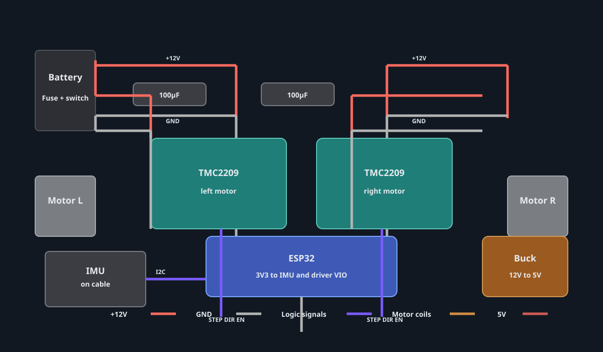

# BennyBot
[BennyBot circuit sim
](https://wokwi.com/projects/477792740217917441)

A self balancing bot that will evolve as time passes.

## Project gallery

### Wiring diagram

This wiring diagram shows the current hardware concept for the balance bot, including the dual TMC2209 drivers, ESP32, MPU6050, battery input, and 12V-to-5V buck converter.

## Source code

This is the source code for the current balancing bot implementation:

- [BennyBotUpd.ino](./BennyBotUpd.ino) — main source code
- [BennyBot.ino](./BennyBot.ino) — earlier version

## Bot overview

Phase 1 (make it balance):

Parts used:
- Microcontroller: ESP32 WROOM
- Motor: NEMA 17 stepper motor
- Motor drivers: TMC2209
- IMU sensor: MPU6050
- LiPo battery: Ovonic Air 2200 mAh 50C
- Chassis: 3D printed (in progress)
- Wheels: 3D printed (in progress)

Potential applications used or to be used:
- AutoCAD Fusion 360: for chassis and wheels to be 3D printed
- KiCad: for the schematic drawing of the circuit
- GitHub: to store the code for the project (keep it open source)
- Arduino IDE: for coding the PID loop. Libraries include the AccelStepper library and MPU6050 library.

What it is:
This phase we will be implementing a tilt-angle control system through a PID controller driving the error to zero in real time. The bot will have two wheels connected to the NEMA 17 motors, which will be controlled by the ESP32 and the TMC2209 drivers.
